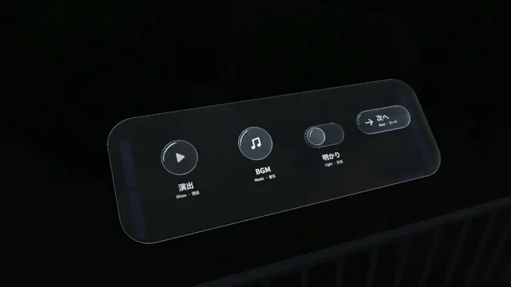

# interact-uikit

XRift のワールド内に設置する、インタラクト用 3D UI コンポーネント集です。


現在は **GlassUI**（透明感のあるガラス製のボタン・スイッチ・スライダー・ベースプレート）を収録しています。フォルダを 1 つコピーするだけで導入できます。

- 画面上に重ねる 2D の Web UI（HTML オーバーレイ）ではなく、3D 空間内に実体として配置するオブジェクトです
- クリック判定には XRift 標準の `Interactable` をそのまま使用しつつ、押し込みアニメーション・波紋・効果音・振動（ハプティクス）のフィードバックを追加しています
- スライダーは、溝の両端の − ＋ ボタンで値を動かします（値の位置まで溝が光ります。スライダーは XRift 本番環境ではまだ試していません）
- 外部の画像・音声・フォントファイルは不要です（アイコンや文字は動的に描画し、効果音はリアルタイムに合成します）
- ラベルは日本語・英語・中国語の 3 言語を併記できます
- XRift 本番環境での動作を確認済みです



> **English** — In-world controls for [XRift](https://xrift.net) worlds (React Three Fiber): clear glass buttons, a switch, a
> slider and a mounting plate, pressed through XRift's `Interactable`. No HTML overlay and no asset files. There is no npm package: copy the
> `GlassUI` folder into `src/components/` of your world. A short guide in English is [at the end](#english-summary).

## 設計方針

1. **空間内に存在する「モノ」として配置する**  
   画面に張り付く HUD ではなく、手すり・台座・柱などに固定されたパネルとボタンとして表現します。プレイヤーが立ち止まる場所に設置し、近づいて操作する設計です。PC・スマートフォン・VR のどのデバイスでも、同じ場所に同じオブジェクトが存在します。
2. **本当に必要な操作だけを置く**  
   ワールド内で実際に使用する機能だけを配置します。ダミーのパネルや使わないボタンは置きません。
3. **操作のフィードバックはコンポーネント側で完結させる**  
   XRift からはホバー（照準が合っている状態）の通知を取得できないため、押し込み・波紋・効果音・振動・エッジの発光といった反応はすべてコンポーネント側で制御しています。
4. **軽量に保つ**  
   背景の屈折やブラーなどの重い描画処理は行わず、エッジのハイライトと環境反射の計算だけでガラスの質感を表現しています。外部アセットの読み込みも発生しません。
5. **同期データは最小限にする**  
   インスタンス内の全員で演出などを同期する場合も、送信するのは「開始時刻」のみとし、経過状態は共有クロックをもとに各クライアント側で計算します。

## 使い方

`xrift create world` で作成した XRift ワールドのプロジェクトに導入します。依存パッケージ（`three`、`@react-three/fiber`、`@xrift/world-components`、`react`）はすべてテンプレートに標準で含まれています。npm パッケージとしては公開していないため、フォルダを直接コピーして使用してください。

**1. `GlassUI` フォルダをプロジェクトの `src/components/GlassUI` にコピーする**

```bash
git clone --depth 1 https://github.com/WebXR-JP/interact-uikit.git
```

```bash
cp -r interact-uikit/GlassUI my-world/src/components/GlassUI
```

**2. ベースプレートにボタンを配置し、ワールド内のオブジェクトに設置する**

```tsx
// File: src/components/Controls.tsx
import { useState } from 'react'
import { GlassButton, GlassPlate, type LabelText } from './GlassUI'

// ラベルはコンポーネント外で定数として定義する（日本語を大きく、英語・中国語を小さく併記）
const MUSIC: LabelText = { ja: 'BGM', en: 'Music', zh: '音乐' }

/** ボタンを1つ載せた小型パネル。柱や手すりの上など、プレイヤーが立ち止まる場所に設置する */
export const Controls = () => {
  const [music, setMusic] = useState(true)
  return (
    <GlassPlate width={0.3} height={0.3} position={[0, 1.05, -1]} rotation={[-0.85, 0, 0]}>
      <GlassButton
        id="bgm"
        position={[0, 0.03, 0.026]}
        icon="music"
        tint="#63d6ff"
        label={{ ja: 'BGM', en: 'Music', zh: '音乐' }} // 日本語を大きく、英語と中国語を小さく添える
        on={music}
        onPress={() => setMusic((value) => !value)}
        hint="BGM を切り替える · Toggle music · 切换音乐"
      />
    </GlassPlate>
  )
}
```

各コンポーネントの正面は `+z` 方向です。プレートを少し手前に傾けると（上記の例では `-0.85` ラジアン）、見下ろした際に操作しやすくなります。  
コンポーネント自体は ON/OFF の状態を持たない（ステートレスな）ため、状態は `on` プロパティで渡し、`onPress` で更新してください。  
ラベル `{ ja, en, zh }` や自作アイコン関数は、描画する内容で比較しています。再レンダリングのたびに新しいオブジェクトを渡しても、内容が同じであればテクスチャは再生成されません。

**3. ガラスの環境反射カラーをワールドの空の色に合わせる**（初期化時に 1 回呼ぶだけ。省略時は夕暮れ向けのデフォルト色になります）

```ts
import { setGlassEnvironment } from './components/GlassUI'

// リニア RGB で指定
setGlassEnvironment({ sky: [0.05, 0.07, 0.14], horizon: [0.3, 0.2, 0.24], ground: [0.01, 0.012, 0.016] })
```

**4. 動作確認する**  
`npm run typecheck` で型チェックを通し、`npm run dev` で実際に近づいてボタンを押せるか確認します。ワールドをアップロードした後は、**必ず XRift 本番環境でもボタンを押せるか確認してください**（開発環境と本番環境で挙動が異なる点があります。詳細は後述の「注意点」を参照してください）。

各コンポーネントのプロパティや仕様の詳細は、[GlassUI/README.md](GlassUI/README.md) にまとまっています（フォルダごとプロジェクトにコピーして参照できます）。

### AI エージェント（LLM）に実装を依頼する場合

このリポジトリの URL を AI エージェントに渡し、「`GlassUI` を導入して、〇〇のボタンを△△に設置して」と指示するだけで実装できます。エージェントは以下の手順に従ってください。

- `GlassUI` フォルダを `src/components/GlassUI` にそのままコピーする（内部のファイルは変更しない）
- 設置場所を決める。プレイヤーが立ち止まる場所にある手すり・台座・柱などに `GlassPlate` を配置し、ボタン類はその子要素として載せる。プレイヤーの立ち位置から約 1m の距離にし、空中に浮かせたり HTML オーバーレイを使ったりしない
- 依頼された機能のみを配置し、サンプル用や予備のボタンは追加しない
- 各コンポーネントにはワールド内で一意な `id` を付与する。状態は親コンポーネント側で管理し、`on` と `onPress` で接続する
- インスタンス全体で共有する状態には `useInstanceState` を使用する。時間経過を伴う演出などは「開始時刻」のみを保存し、`useServerClock` から進捗を計算する（参考: [examples/useControls.ts](examples/useControls.ts)）
- `label` は `{ ja, en, zh }` 形式で渡し（コンポーネント外の定数にしても、その場に記述してもよい。描画する文字列が同じならテクスチャは再生成されない）、`hint` にも 3 言語を併記する
- コライダー（`CuboidCollider` など）でボタン全体を覆わない。アバターのめり込みを防ぎたい場合は、ボタンより低い位置（足元〜手すりの高さ）にのみコライダーを配置する（参考: [examples/ControlPanel.tsx](examples/ControlPanel.tsx)）
- `setGlassEnvironment` を 1 度呼び出し、ワールドの空・地平線・地面の色を設定する
- `npm run typecheck` を実行してエラーがないことを確認する。開発サーバーで動作確認を行ったうえで、アップロード後に本番環境でもテストするようユーザーに案内する

## 注意点：XRift の `Interactable` の仕様とハマりどころ

`@xrift/world-components`（v0.66）の実装調査および本番ワールドでの運用から判明している仕様と注意点です。

- **インタラクト可能な距離は約 3.5m まで**  
  開発環境では視点の中心から 3.5m 以内のオブジェクトのみ操作可能です。立ち位置から 1m 前後の場所に設置すると操作しやすくなります。
- **ホバー（照準）イベントは取得できない**  
  `Interactable` に渡せる主なプロパティは `id`・`onInteract`・`interactionText`・`enabled`（および現在 `'button'` 固定の `type`）のみです。照準を合わせた際はプラットフォーム側の `interactionText` が表示されるだけで、ワールド側には通知されません。そのため、`GlassUI` では「画面中央からのレイが部品と交差しているか」を自前で計算してエッジを発光させています（VR でコントローラーのレーザーポインターだけを向けた場合は発光しませんが、クリック判定自体は XRift 側で行われるため操作は可能です）。
- **レイヤー設定はマウント時に確定する**  
  `Interactable` はマウント時に自身のグループと子要素をレイヤー `11` に登録します。後から動的に追加した子要素は登録されません。また、レイヤー `12`・`13`（システム用）、`9`・`10`（アバター表示用）、`14`（Grabbable 用）もプラットフォーム側で予約されているため、ワールド内のオブジェクトをこれらのレイヤーに手動で割り当てないでください。
- **ボタンをコライダー（当たり判定）で覆わない**  
  アバターが操作盤にめり込まないよう、ボタンごと覆う高さのコライダーを設置したところ、**開発環境では押せるにもかかわらず、XRift 本番環境では一切ボタンが押せなくなる**事象が発生しました。コライダーを手すりの高さまで下げてボタンをコライダーの外に出すことで解決したため、コライダーは「ボタンより低く、視点からボタンへの射線を遮らない位置」に配置してください。
- **装飾用のパーティクル（`Points`）はレイキャスト対象から外す**  
  Three.js の `Points` はデフォルトの当たり判定閾値が大きく（約 1m 以内を通過するとヒット扱いになる）、`visible = false` でもレイキャストに反応します。ボタン付近に光の粒子などを配置すると見えない壁となってクリックを阻害するため、装飾用の `Points` には必ず `raycast={() => {}}` を指定してください（`GlassUI` 内部のパーティクルには設定済みです）。
- **R3F の `onClick` を併用しない**  
  `Interactable` と React Three Fiber の `onClick` を同じ要素に設定すると、両方が発火して ON/OFF が即座に打ち消し合うことがあります。なお、`GlassUI` 側でも 0.14 秒以内の連続入力を 1 回として扱うチャタリング防止（デバウンス）処理を入れています。
- **時間経過する処理は「開始時刻」だけを同期する**  
  `useInstanceState(key, initialValue)` はインスタンス内の全員で共有されるステートです。演出・動画・花火など時間で進行するギミックは「開始時刻」のみをステートに保存し、`useServerClock().now()`（共有サーバー時刻をミリ秒で返す関数）との差分から各クライアントで現在の状態を計算してください。通信がボタンを押した瞬間の 1 回だけで済み、途中参加したユーザーにもズレなく同じ状況が再現されます。

※本番環境でボタンが押せなくなった際は、「コライダーの高さ調整」と「`Points` のレイキャスト無効化」を同時に行って解決しました。単独での原因切り分けは行っていないため、必ず両方の対策を守るようにしてください。

## サンプル

[examples/ControlPanel.tsx](examples/ControlPanel.tsx) は、2 本の支柱に傾斜したプレートを取り付けた自立型の操作盤サンプルです。  
丸ボタン（進捗リング付き）、丸ボタン（ON/OFF トグル）、トグルスイッチ、カプセル型ボタン（単発実行）を並べています。状態管理のロジックは [examples/useControls.ts](examples/useControls.ts) に分離しています。


```tsx
// ワールド内で1回だけ呼び出し、操作盤（入力側）と演出コンポーネント（参照側）の両方に渡す
const controls = useControls()

// 原点は床面。プレートは +z 方向（プレイヤーが立つ側）かつ斜め上を向く
<ControlPanel controls={controls} position={[0, 0, -2]} />
```

操作盤の実装抜粋（わかりやすくするため定数を数値に展開し、色やヒント文字列は省略しています）：

```tsx
<GlassPlate width={1.04} height={0.36} position={[0, 1.062, 0]} rotation={[-0.85, 0, 0]}>
  {/* 時間で進行する演出: 外周の進捗リングを「開始時刻」と「共有クロック」から毎フレーム計算 */}
  <GlassButton id="panel-show" position={[-0.3375, 0.03, 0.026]} icon={showOn ? 'stop' : 'play'} label={LABELS.show} on={showOn}
    progress={showOn ? () => Math.min(Math.max((now() - show.startedAt) / SHOW_LENGTH, 0), 1) : undefined} onPress={controls.toggleShow} />
  {/* ON / OFF トグル */}
  <GlassButton id="panel-music" position={[-0.1125, 0.03, 0.026]} icon="music" label={LABELS.music} on={music} onPress={controls.toggleMusic} />
  <GlassSwitch id="panel-light" position={[0.1125, 0.015, 0.026]} label={LABELS.light} on={light} onPress={controls.toggleLight} />
  {/* 単発アクション（on を渡さない） */}
  <GlassButton id="panel-next" position={[0.3375, 0.03, 0.026]} shape="pill" size={0.08} width={0.2} icon="next" label={LABELS.next} onPress={controls.next} />
</GlassPlate>

{/* ボタンより低い位置にのみコライダーを置き、アバターの移動だけを止める（ボタンを覆わない） */}
<RigidBody type="fixed" colliders={false}>
  <CuboidCollider args={[0.59, 0.375, 0.18]} position={[0, 0.375, 0]} />
</RigidBody>
```

インスタンス全体での状態共有（`useControls.ts` より抜粋）：

```ts
const clock = useServerClock()
const clockRef = useRef(clock)
clockRef.current = clock
/** 共有サーバー時刻（秒）。関数として切り出すことで、useFrame 内から再レンダリングなしで参照できる */
const now = useCallback(() => clockRef.current.now() / 1000, [])

// 同期するのは再生フラグと「開始時刻」のみ
const [show, setShow] = useInstanceState<ShowState>('panel-show', { playing: false, startedAt: 0 })

const toggleShow = useCallback(() => {
  const time = now()
  // 再生中なら停止し、停止中または再生終了後であれば現在時刻から開始する
  setShow((previous) =>
    previous.playing && time < previous.startedAt + SHOW_LENGTH
      ? { playing: false, startedAt: previous.startedAt }
      : { playing: true, startedAt: time + SHOW_LEAD },
  )
}, [now, setShow])
```

演出を描画する側では、経過秒数を `controls.now() - controls.show.startedAt` で算出します。この値は全クライアントで一致するため、経過秒数に応じた処理を決定論的に記述すれば、全員に同じ演出が同期して表示されます。

サンプルを自分のワールドで試す場合は、`examples` 内の 2 ファイルを `src/components/ControlPanel/` に配置すれば `import` パスを書き換えずにそのまま動作します（コライダーにはテンプレート標準の `@react-three/rapier` を使用しています）。

冒頭の画像は、実際のワールドで稼働している操作盤です。夜景を見渡す手すりに設置されており、ボタンを押して顔を上げると正面に花火が打ち上がります。


## 動作確認環境

- **型チェック**: XRift ワールドテンプレートの標準設定（`strict`、`noUnusedLocals` 等）でパスすることを確認済み  
  （`three` 0.183、`@react-three/fiber` 9.5、`@react-three/rapier` 2.2、`@xrift/world-components` 0.66、React 19.2、TypeScript 5.9）
- **本番動作**: XRift 本番環境にて操作盤のボタンを押せることを確認済み（2026年11月）
- **未検証の項目**: スマートフォンおよび VR ヘッドセット実機での操作感（ハプティクス振動を含む）、昼間などの明るい環境下での視認性

## ライセンス

[MIT](LICENSE)
