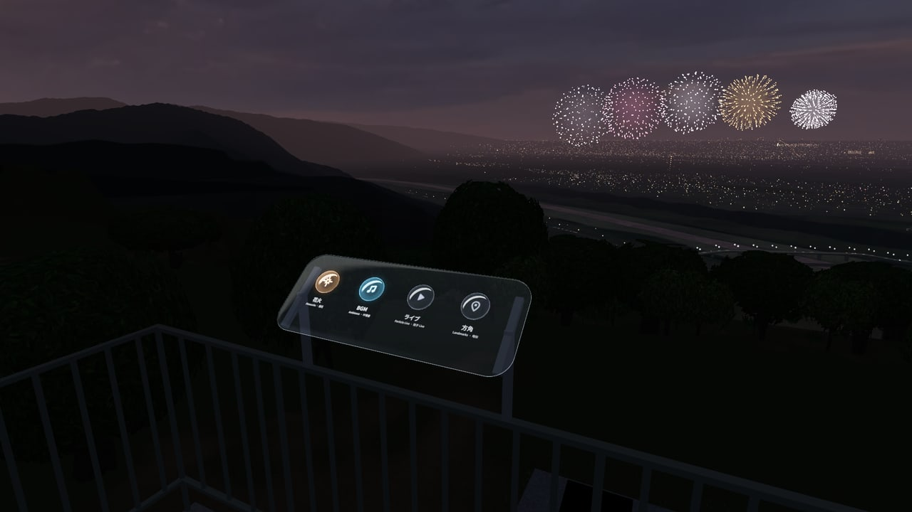
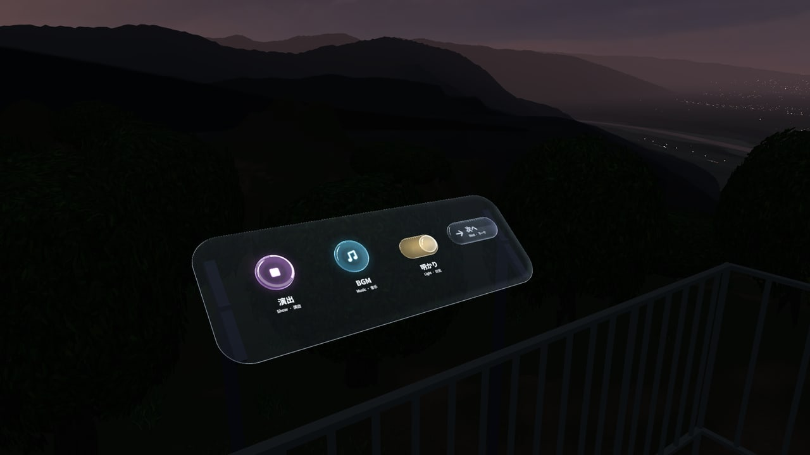
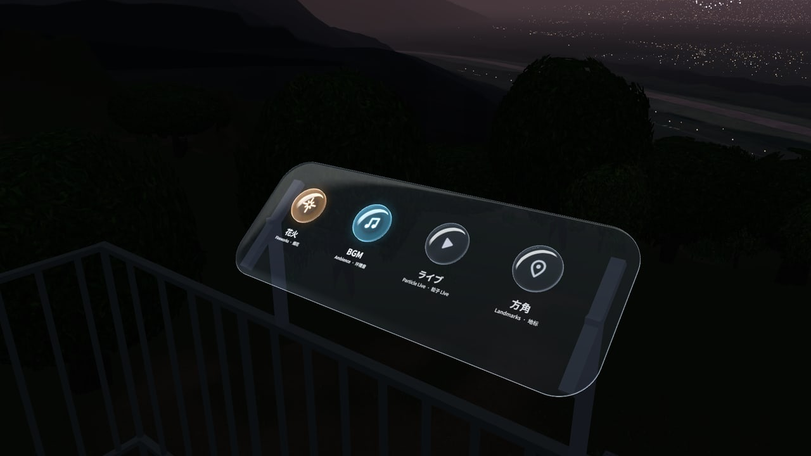

# interact-uikit

XRift のワールドの中に置く、インタラクト用の UI の部品集です。



いま入っているのは **GlassUI**（澄んだガラスのボタン・スイッチ・台の板）です。フォルダーを 1 つ写すだけで使えます。

- 画面に重ねる Web の UI（HTML）ではなく、ワールドの中に立っている物です
- 押すしくみは XRift の `Interactable`（狙って押す）のまま。そこに、沈み込み・波紋・音・震えの手ごたえを足してあります
- 画像・音源・フォントのファイルを使いません（アイコンと文字はその場で描き、音はその場で合成します）
- ラベルは日本語・英語・中国語を並べて出せます
- XRift 本番で、押せることを確かめてあります


> **English** — In-world controls for [XRift](https://xrift.net) worlds (React Three Fiber): clear glass buttons, a switch and a
> mounting plate, pressed through XRift's `Interactable`. No HTML overlay and no asset files. There is no npm package: copy the
> `GlassUI` folder into `src/components/` of your world. A short guide in English is [at the end](#english-summary).

## 考え方

1. **UI は「その場所にある物」として作る。** 画面に重ねる表示ではなく、手すり・台・柱に据え付けた板と、その上のボタンです。
   人が立ち止まる場所に置き、そこへ歩いていって押します。PC でも、スマホでも、VR でも、同じ物が同じ場所にあります。
2. **必要な操作だけを置く。** そのワールドで実際に使う操作だけにします。見本の板や、使わないボタンは置きません。
3. **押した手ごたえは、ワールドの側で返す。** XRift は「いま狙われている」ことをワールドに知らせません。
   沈み込み・波紋・音・震え・縁の光は、部品が自分で作ります。
4. **軽く保つ。** 向こうの景色を取り込んで曲げたりぼかしたりはせず、縁の光と映り込みだけでガラスに見せています。
   読み込むファイルもありません。
5. **共有するのは最小限に。** 全員で同じものを見たいときも、送るのは「始めた時刻」だけにして、
   あとは共有の時計から、各自が同じように計算します。

## 使い方

XRift のワールドのプロジェクト（`xrift create world` で作ったもの）に入れます。必要なパッケージ
（`three`、`@react-three/fiber`、`@xrift/world-components`、`react`）は、テンプレートに最初から入っています。
npm のパッケージにはしていません。フォルダーを写して使います。

**1. `GlassUI` フォルダーを、ワールドの `src/components/GlassUI` に丸ごと写す**

```bash
git clone --depth 1 https://github.com/WebXR-JP/interact-uikit.git
```

```bash
cp -r interact-uikit/GlassUI my-world/src/components/GlassUI
```

**2. 板に載せて、ワールドの中の物に据え付ける**

```tsx
// src/components/Controls.tsx
import { useState } from 'react'
import { GlassButton, GlassPlate, type LabelText } from './GlassUI'

// ラベルは部品の外で決めておく（日本語を大きく、英語と中国語を小さく添える）
const MUSIC: LabelText = { ja: 'BGM', en: 'Music', zh: '音乐' }

/** ボタンを 1 つ載せた小さな板。柱や手すりの上など、人が立ち止まる所に据え付ける */
export const Controls = () => {
  const [music, setMusic] = useState(true)
  return (
    <GlassPlate width={0.3} height={0.3} position={[0, 1.05, -1]} rotation={[-0.85, 0, 0]}>
      <GlassButton
        id="bgm"
        position={[0, 0.03, 0.026]}
        icon="music"
        tint="#63d6ff"
        label={MUSIC}
        on={music}
        onPress={() => setMusic((value) => !value)}
        hint="BGM を切り替える · Toggle music · 切换音乐"
      />
    </GlassPlate>
  )
}
```

部品は +z を向いています。板を少し寝かせると（上の例では 0.85 ラジアン）、見下ろしたときに押しやすくなります。
部品は入／切の状態を持ちません。`on` で渡し、`onPress` で切り替えます。

**3. ガラスに映る色を、ワールドの空に合わせる**（1 度呼ぶだけ。省くと夕暮れ向きの色）

```ts
import { setGlassEnvironment } from './components/GlassUI'

setGlassEnvironment({ sky: [0.05, 0.07, 0.14], horizon: [0.3, 0.2, 0.24], ground: [0.01, 0.012, 0.016] }) // リニア rgb
```

**4. 確かめる。** `npm run typecheck` を通し、`npm run dev` で歩いていって押します。
アップロードしたら、XRift 本番でも 1 回押してください（開発用のページでは分からない違いがあります。下の「落とし穴」）。

部品の一覧と指定のしかたは [GlassUI/README.md](GlassUI/README.md) にあります（フォルダーと一緒にワールドへ持っていけます）。

### AI エージェント（LLM）に頼むとき

このリポジトリの URL を渡して、「GlassUI を入れて、○○のボタンを△△に置いて」と頼めば足ります。エージェントは次の順に進めてください。

- `GlassUI` フォルダーを、ワールドの `src/components/GlassUI` に丸ごと写す。中のファイルは書き換えない
- 置く場所を決める。人が立ち止まる所にある物（手すり・台・柱）に `GlassPlate` を据え付け、部品はその上に載せる。
  立つ位置から 1 m 前後にする。宙に浮かべない。HTML を重ねない
- 置くのは、頼まれた操作だけにする。見本や予備のボタンは足さない
- 部品ごとに、ワールドの中で重ならない `id` を付ける。状態は使う側で持ち、`on` と `onPress` でつなぐ
- 全員で共有する状態は `useInstanceState` に入れる。時間で進むものは「始めた時刻」だけを入れ、
  `useServerClock` の時計から計算する（[examples/useControls.ts](examples/useControls.ts)）
- ラベルは `{ ja, en, zh }` で渡し、コンポーネントの外で定数にする。`hint` も 3 つの言語を並べる
- 当たり判定（`CuboidCollider` など）でボタンを包まない。体を止めたいときは、ボタンより低い箱を足元に置く
  （[examples/ControlPanel.tsx](examples/ControlPanel.tsx)）
- `setGlassEnvironment` に、ワールドの空・地平線・地面の色を 1 度渡す
- `npm run typecheck` を通す。開発用のページで押して確かめ、アップロードのあと本番で 1 回押してもらうよう、ユーザーに伝える

## 落とし穴: XRift の `Interactable` で分かっていること

`@xrift/world-components` 0.66 の中身を読んだことと、実際のワールドで起きたことです。

- **届くのは 3.5 m ほど。** 開発用の環境では、視点の中心から 3.5 m までの物だけが押せます。立ち止まる場所から 1 m 前後に置くと押しやすくなります。
- **「狙われている」という通知は来ない。** `Interactable` に渡せるのは `id`・`onInteract`・`interactionText`・`enabled`
  （と、いまは `'button'` しか選べない `type`）だけです。
  狙ったときに出るのは、プラットフォームが表示する `interactionText` だけなので、縁を光らせるような反応はワールドの側で作ります。
  GlassUI は「視線の先（画面の中央）が部品に重なったか」を自分で計算しています
  （VR でコントローラーの光線だけを向けたときには光りません。押すこと自体は XRift 側の判定なので、光線でも押せます）。
- **レイヤーは、置かれた時点で決まる。** `Interactable` は、置かれたとき（マウント時）に、自分のグループと子をレイヤー 11 に入れます。
  あとから足した子は入りません。狙いの判定はプラットフォームの側が行います。レイヤー 12 と 13 もプラットフォームが使っています
  （9・10 は自分の体の表示、14 は掴める物）。ワールドの物を、これらのレイヤーに自分で入れないでください。
- **ボタンを当たり判定で包まない。** 体が操作盤に入り込まないよう、ボタンごと包む背の高い当たり判定の箱を置いたところ、
  XRift 本番ではどのボタンも押せなくなりました（開発用のページでは押せていました）。箱を手すりの高さまで下げて、
  ボタンを箱の外に出すと、押せるようになりました。当たり判定は、ボタンより低く、目からボタンへの線にかからない所に置きます。
- **飾りの点は、狙いの判定から外す。** three.js の点の集まり（`Points`）は、光線が 1 m 以内を通ると当たったことになり、
  `visible = false` でも当たります。ボタンの近くに光の粒を置くと、ボタンの手前に見えない当たりができます。
  飾りの点には `raycast={() => {}}` を付けます（GlassUI の光の粒には付けてあります）。
- **同じ物に、R3F の `onClick` も付けない。** 両方が反応して、入／切が打ち消し合うことがあります。
  GlassUI は、0.14 秒以内に続けて届いた「押した」を 1 回として扱います。
- **共有するのは「始めた時刻」だけにする。** `useInstanceState(名前, 初期値)` は、そのインスタンスの全員で共有される `useState` です。
  時間で進むもの（演出・動画・花火）は、始めた時刻だけを入れておき、`useServerClock().now()`（共有の時計。ミリ秒を返す関数）から、
  各自が同じように計算します。通信は押したときの 1 回で済み、あとから入った人にも、途中からそのまま同じに見えます。

本番で押せなくなったときは、当たり判定の箱と光の粒の 2 つを同時に直しました。どちらが原因だったかは切り分けていないので、両方とも守ってください。

## サンプル

[examples/ControlPanel.tsx](examples/ControlPanel.tsx) は、2 本の支柱に傾けた板を載せた操作盤です。
丸ボタン（進み具合の輪つき）、丸ボタン（入／切）、スイッチ、カプセル（押すだけ）が並んでいます。
状態は [examples/useControls.ts](examples/useControls.ts) にあります。



```tsx
// ワールドの中で 1 回だけ呼び、操作盤（押す側）と演出（使う側）の両方に渡す
const controls = useControls()

<ControlPanel controls={controls} position={[0, 0, -2]} />   // 原点は床の高さ。板は +z（人が立つ側）と上を向く
```

操作盤の中身（抜粋。寸法は数値に直し、色と説明の文は省いてあります）:

```tsx
<GlassPlate width={1.04} height={0.36} position={[0, 1.062, 0]} rotation={[-0.85, 0, 0]}>
  {/* 時間で進むもの: 縁の輪は、始めた時刻と共有の時計から毎フレーム計算する */}
  <GlassButton id="panel-show" position={[-0.3375, 0.03, 0.026]} icon={showOn ? 'stop' : 'play'} label={LABELS.show} on={showOn}
    progress={showOn ? () => Math.min(Math.max((now() - show.startedAt) / SHOW_LENGTH, 0), 1) : undefined} onPress={controls.toggleShow} />
  {/* 入／切 */}
  <GlassButton id="panel-music" position={[-0.1125, 0.03, 0.026]} icon="music" label={LABELS.music} on={music} onPress={controls.toggleMusic} />
  <GlassSwitch id="panel-light" position={[0.1125, 0.015, 0.026]} label={LABELS.light} on={light} onPress={controls.toggleLight} />
  {/* 押すだけ（on を渡さない） */}
  <GlassButton id="panel-next" position={[0.3375, 0.03, 0.026]} shape="pill" size={0.08} width={0.2} icon="next" label={LABELS.next} onPress={controls.next} />
</GlassPlate>

{/* ボタンより低い箱で、体だけを止める（ボタンを包まない） */}
<RigidBody type="fixed" colliders={false}>
  <CuboidCollider args={[0.59, 0.375, 0.18]} position={[0, 0.375, 0]} />
</RigidBody>
```

全員で共有する状態（`useControls.ts` から）:

```ts
const clock = useServerClock()
const clockRef = useRef(clock)
clockRef.current = clock
/** 共有の時計（秒）。関数なので、useFrame の中から描き直しなしで呼べる */
const now = useCallback(() => clockRef.current.now() / 1000, [])

// 共有するのは「いつ始めたか」だけ
const [show, setShow] = useInstanceState<ShowState>('panel-show', { playing: false, startedAt: 0 })

const toggleShow = useCallback(() => {
  const time = now()
  // 流れている途中なら止める。止まっているか、もう終わっていれば、いまから始める
  setShow((previous) =>
    previous.playing && time < previous.startedAt + SHOW_LENGTH
      ? { playing: false, startedAt: previous.startedAt }
      : { playing: true, startedAt: time + SHOW_LEAD },
  )
}, [now, setShow])
```

使う側は、始まってからの秒数を `controls.now() - controls.show.startedAt` で求めます。この値は全員で同じになるので、
そこから先（どこまで進んだか、何をどこに出すか）を同じ式で決めれば、全員に同じものが見えます。

サンプルを自分のワールドで試すときは、`examples` の 2 つのファイルを `src/components/ControlPanel/` に置くと、
`import` はそのまま通ります（当たり判定に `@react-three/rapier` を使います。これもテンプレートに入っています）。

1 枚めの絵は、実際のワールドで使っている操作盤です。街を眺める側の手すりに据え付けてあり、ボタンを押して顔を上げると、正面に花火が上がります。



## 確かめたこと

- 型チェック: XRift のワールドのテンプレートと同じ設定（`strict`、`noUnusedLocals` など）で通ります
  （`three` 0.183、`@react-three/fiber` 9.5、`@react-three/rapier` 2.2、`@xrift/world-components` 0.66、React 19.2、TypeScript 5.9）
- XRift 本番で、操作盤のボタンが押せること（2026 年 11 月）
- まだ確かめていないこと: スマホと VR 機器の実機での動作（震えを含む）、昼間のような明るいワールドでの見え方

## ライセンス

[MIT](LICENSE)

## English summary

**What it is.** `GlassUI` is a self-contained folder of in-world controls for XRift worlds: `GlassButton` (round, pill or image tile),
`GlassSwitch` and `GlassPlate`. They are 3D objects pressed through XRift's `Interactable`, with a spring press, a ripple, a short
tone and haptics added. Icons and labels are drawn on a canvas and tones are synthesised, so there are no asset files.
Labels can show Japanese, English and Chinese together (`{ ja, en, zh }`).

**The idea.** Build UI as a thing that stands at a place in the world (a plate fixed to a railing, a stand or a post where people
stop), not as an overlay on the screen. Place only the controls the world needs.

**Use.** Copy `GlassUI/` into `src/components/GlassUI/` of a world made with `xrift create world` (its dependencies are already in
the template), mount the parts on a `GlassPlate`, keep the state yourself (`on`, `onPress`) and call `setGlassEnvironment` once
with the sky colours of the world. Props are listed in [GlassUI/README.md](GlassUI/README.md) (Japanese); a worked example is in
[examples/](examples).

**Pitfalls found with `Interactable` (`@xrift/world-components` 0.66).**

- The reach is about 3.5 m; put controls about 1 m from where people stand.
- The world gets no hover callback. Hover feedback has to be computed in the world (GlassUI tests the centre of the view).
- `Interactable` puts its children on layer 11 when it mounts; the platform does the aiming. Layers 12 and 13 are also used by the platform.
- Never enclose buttons in a physics collider. With a tall body-blocking box around the buttons, none of them could be pressed on
  the platform, although the dev page still worked. Keep such colliders lower than the buttons and out of every eye-to-button line.
- three.js `Points` are hit when the ray passes within 1 m, even when invisible. Give decorative points near a control `raycast={() => {}}`.
- For state shared by everyone, store only the start time in `useInstanceState` and derive the rest from `useServerClock().now()`.
